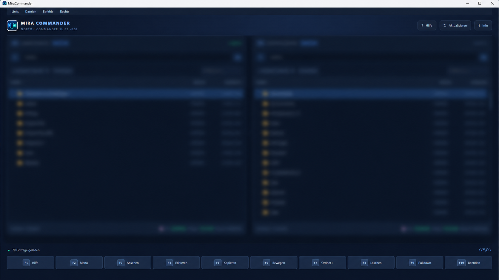

# MiraCommander

**A modern, keyboard-first dual-pane file manager inspired by Norton Commander.**

Built with **Rust, Tauri 2 and TypeScript**, MiraCommander combines classic function-key workflows with a modern desktop interface.

[Explore features](#-features) · [Build from source](#️-development-and-build) · [Report a bug](https://github.com/OlgunBeyaz/MiraCommander/issues) · [Releases](https://github.com/OlgunBeyaz/MiraCommander/releases)

> **Availability:** Check the [Releases page](https://github.com/OlgunBeyaz/MiraCommander/releases) for published installers. Platform and package support described below is a project target and may depend on the current build.

👤 **Author and developer:** Kemal Akçocuk

📄 **License:** MIT License (open source)

## 📸 Screenshot



---

## 🌟 Cross-platform

MiraCommander is designed for **cross-platform** desktop use. Planned build targets include:
- 🐧 **Linux** (Debian, Ubuntu, Fedora, Arch, and more; `.deb`, `.rpm`, `AppImage`)
- 🪟 **Windows** (Windows 10 / 11; `.msi`, `.exe`)
- 🍏 **macOS** (Apple silicon M1/M2/M3 and Intel; `.dmg`, `.app`)

### Platform-specific details
- **Paths and separators:** Handles Windows backslashes `\` and Unix-style `/` paths with automatic detection.
- **Drive detection:** Automatically detects Windows drive letters (`C:\`, `D:\`, ...) and Unix mount points (`/`, `/mnt`, `/media`, `/Volumes`, `/home`).
- **Disk space:** Cross-platform disk space detection for Windows, Linux, and macOS filesystems using `fs4`.
- **Hidden files:** Supports both Unix dotfiles (`.filename`) and the Windows `FILE_ATTRIBUTE_HIDDEN` attribute.
- **Permissions and symlinks:** Handles symlinks and permissions according to each platform.
- **System associations:** Opens files with their default applications through native OS integration (`opener`).

---

## ✨ Features

- **Dual-pane view:** Fast keyboard navigation with `Tab`, the arrow keys, `Enter`, and `..`.
- **Norton Commander function keys:**
  - `F1` Help and keyboard shortcuts
  - `F2` User menu (system commands such as `git status`, `df`, etc.)
  - `F3` Viewer for text files and images
  - `F4` Editor with save support and unsaved-change checks before closing
  - `Shift+F4` Create and edit a new file
  - `F5` Copy with live progress, a `✓` indicator, and conflict options (Skip / Overwrite / Cancel)
  - `F6` Move files or folders
  - `Shift+F6` Rename a file or folder
  - `F7` Create a folder
  - `F8` Delete with a confirmation prompt
  - `F9` Norton Commander pull-down menu (Left / Files / Commands / Right)
  - `F10` Quit
- **Command line and history:**
  - A command input line at the bottom, rooted in the current working directory.
  - `Ctrl + Enter`: Insert the selected filename into the command line.
  - `Alt + F8` and the arrow keys: Browse command history.
- **Quick View (`Ctrl+Q`):**
  - Preview files and images directly in the opposite pane.
- **Universal Image Viewer:**
  - Supports PNG, JPG, GIF, WebP, SVG, BMP, ICO, TIFF, TGA, AVIF, HDR, QOI, PNM, DDS, and more.
  - Smooth zoom, mouse panning, rotation (↺/↻), and arrow-key navigation.
- **Archive tools:**
  - `Alt + F5`: Pack selected files into a ZIP archive, including Zip64 support for files over 4 GB.
  - `Alt + F6`: Safely extract ZIP archives with Zip Slip protection.
- **File search (`Alt+F7`):**
  - Recursive search using patterns (`*.rs`, `test*`, etc.), with optional full-text search inside files.
- **Directory comparison (`Ctrl+D`):**
  - Find and highlight differences between the left and right panes.

---

## 🛠️ Development and build

### Prerequisites
1. [Node.js](https://nodejs.org/) (version 18 or later)
2. [Rust and Cargo](https://rustup.rs/) (latest stable version)
3. Tauri 2 platform dependencies:
   - **Linux:** `sudo apt install libwebkit2gtk-4.1-dev libappindicator3-dev librsvg2-dev patchelf libgtk-3-dev`
   - **Windows:** Microsoft C++ Build Tools and WebView2
   - **macOS:** Xcode Command Line Tools

### Run in development mode
```bash
npm install
npm run tauri dev
```

### Create a production build
```bash
npm run tauri build
```
The resulting installers are placed in:
- Linux: `src-tauri/target/release/bundle/deb/` or `appimage/`
- Windows: `src-tauri/target/release/bundle/msi/`
- macOS: `src-tauri/target/release/bundle/dmg/`

---

## 📦 Automated multi-platform releases with GitHub Actions

The project documents an automated CI/CD pipeline at `.github/workflows/release.yml`. Verify the workflow and its latest run before relying on downloadable artifacts.

When you push a tag (for example, `git tag v0.2.0 && git push origin v0.2.0`), GitHub Actions automatically builds:
- **Windows executables and installers** (`.exe` / `.msi`)
- **macOS universal binaries and disk images** (`.dmg` for Apple silicon and Intel)
- **Linux packages** (`.deb`, `.AppImage`)

The generated files are attached to the GitHub release.

---

## 📜 License

This project is licensed under the **MIT License** and is free to use and modify.

Copyright (c) Kemal Akçocuk.

## 🤝 Feedback and contributions

MiraCommander is under active development. If you encounter a problem, [open an issue](https://github.com/OlgunBeyaz/MiraCommander/issues) and include your operating system, application version, reproduction steps, and any relevant logs. Feature suggestions and pull requests are welcome.

## 🔗 Mira software projects

Also by this developer: [mdedit](https://github.com/OlgunBeyaz/mdedit), [DLL Export Viewer](https://github.com/OlgunBeyaz/dll-export), and [Homebrew App Store](https://github.com/OlgunBeyaz/Homebrew-App-Store).
